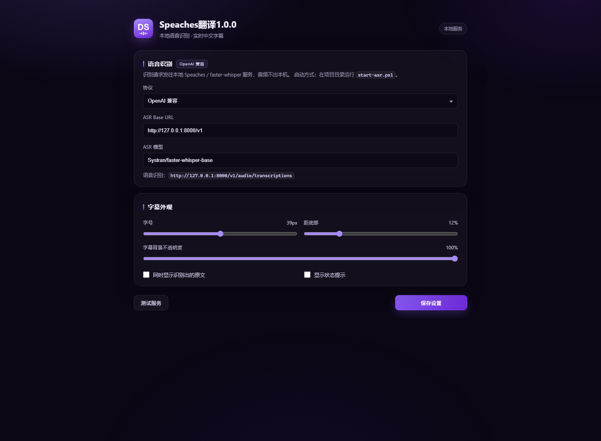

# YT Audio Translator

**A Manifest V3 Chrome extension that captures a YouTube tab's audio and renders live Simplified Chinese subtitles.**

It never reads YouTube's CC track — it listens to the actual audio, transcribes it locally, translates it locally, and draws the subtitles inside the player (fullscreen works).

> ⚠️ **Not a plug-and-play cloud extension.** Speech recognition and translation both run on **your own machine**, so two local services must be running first (see [One-click setup](#one-click-setup)). In exchange: no API key, no audio or text leaving your computer, and zero running cost.



## Features

- **Audio-first** — works with or without a CC track
- **Fully local** — speech recognition via faster-whisper, translation via `qwen2.5:3b` on Ollama; no network, no key
- **Live subtitle overlay** — rendered inside the player, fullscreen-capable; the original line can be shown side by side
- **Adjustable appearance** — font size, distance from the bottom, backdrop opacity
- **Selection translation** — select text on any page and translate it from the context menu
- **Shortcut** — `Alt + Shift + A` to start/stop

## How it works

```
YouTube tab audio
   │ chrome.tabCapture
   ▼
Offscreen document: AudioContext + energy VAD
   │ 0.6–1.6 s WAV slices (early split on silence)
   ▼
Service worker ──► local ASR  POST /v1/audio/transcriptions   (faster-whisper)
   │ transcribed text, cross-slice de-duplication
   ▼
Service worker ──► local LLM  POST /v1/chat/completions       (Ollama qwen2.5:3b)
   │ streamed Simplified Chinese
   ▼
Content script ──► Shadow-DOM overlay inside the player
```

## Measured latency

On an i5-14600KF + RTX 5060, 7.67 s of audio:

| Stage | Time |
| --- | --- |
| Speech recognition | 0.7–1.0 s per 1.5 s slice |
| Translation | first token 0.03 s, full line 0.09–0.15 s |
| **End to end** | **≈ 1.0–1.5 s** |

## One-click setup

Get the repository first (it contains the installer):

```powershell
git clone https://github.com/LeoHwang74/YT-Audio-Translator.git
cd YT-Audio-Translator
```

Then run:

```powershell
powershell -ExecutionPolicy Bypass -File .\install.ps1
```

The script will:

| Step | What it does |
| --- | --- |
| 1 | Locate Python 3.9+ (tells you where to get it and exits if missing) |
| 2 | Create an isolated venv under `%LOCALAPPDATA%\yt-audio-translator` |
| 3 | Install `faster-whisper` / `fastapi` / `uvicorn` |
| 4 | Download the `base` whisper model (~150 MB, once) |
| 5 | Generate `start-asr.ps1` and `start-all.ps1` |
| 6 | Set `OLLAMA_ORIGINS=*` (required for extension origins) |
| 7 | Run `ollama pull qwen2.5:3b` |
| 8 | Start the ASR service and check `/health` |

Common flags:

```powershell
# more accurate model + more threads
.\install.ps1 -AsrModel small -Threads 20

# different Ollama model
.\install.ps1 -OllamaModel qwen2.5:7b

# skip Ollama entirely
.\install.ps1 -SkipOllama

# install without starting anything
.\install.ps1 -NoStart

# custom install location
.\install.ps1 -InstallDir D:\tools\yt-translator
```

Afterwards, one command starts everything:

```powershell
& "$env:LOCALAPPDATA\yt-audio-translator\start-all.ps1"
```

> The script prints English only — Windows PowerShell reads BOM-less `.ps1` files as ANSI and corrupts non-ASCII text.
> It only touches the `-InstallDir` folder and your user-level `OLLAMA_ORIGINS` variable.

### Optional: start the ASR service at login

Ollama starts with the system on its own; the ASR service does not. To avoid starting it by hand every time, drop a shortcut into the Startup folder:

```powershell
$startup = [Environment]::GetFolderPath('Startup')
$asr = Join-Path $env:LOCALAPPDATA 'yt-audio-translator'
$ws = New-Object -ComObject WScript.Shell
$sc = $ws.CreateShortcut((Join-Path $startup 'yt-translator-asr.lnk'))
$sc.TargetPath = 'powershell.exe'
$sc.Arguments = '-NoProfile -WindowStyle Hidden -ExecutionPolicy Bypass -File "' + (Join-Path $asr 'start-asr.ps1') + '"'
$sc.WorkingDirectory = $asr
$sc.Save()
```

> Use a `.lnk`, not a `.vbs`: if a `.vbs` is saved as ASCII, a non-ASCII path becomes `????`, the script silently starts nothing at login. `.lnk` stores Unicode.

## Manual setup (optional)

If you would rather control every step.

### ① Speech recognition: faster-whisper (port 8000)

You need an OpenAI-compatible `/v1/audio/transcriptions` endpoint. **The implementation ships in this repository**: `tools/asr_server.py` (~150 lines, FastAPI + faster-whisper). `install.ps1` copies it into the install directory and creates the venv.

Running it manually is short:

```bash
pip install faster-whisper fastapi uvicorn python-multipart
python tools/asr_server.py          # listens on 127.0.0.1:8000
```

Environment variables: `WHISPER_MODEL` (default `base`), `WHISPER_THREADS` (default 12), `WHISPER_PORT` (default 8000).

Any other implementation works too, for example [Speaches](https://github.com/speaches-ai/speaches) (Docker):

```bash
docker run -d --name speaches -p 8000:8000 \
  -v speaches-models:/home/ubuntu/.cache/huggingface/hub \
  ghcr.io/speaches-ai/speaches:latest-cpu
```

### ② Translation: Ollama (port 11434)

```bash
ollama pull qwen2.5:3b
```

**Extension origins must be allowed**, otherwise Ollama answers 403:

```bash
# Windows (user environment variable, restart Ollama afterwards)
setx OLLAMA_ORIGINS "*"

# macOS / Linux
export OLLAMA_ORIGINS="*"
```

## Install

1. Download the latest zip from [Releases](../../releases/latest) and unzip it, or clone this repository
2. Open `chrome://extensions` and enable **Developer mode**
3. Click **Load unpacked** and pick the repository root (it must contain `manifest.json` directly)
4. Refresh the YouTube tab

Requires **Chrome 116+** (`offscreen` / `tabCapture`).

## Settings

| Item | Default | Editable |
| --- | --- | --- |
| Protocol | OpenAI compatible | No (fixed) |
| ASR base URL | `http://127.0.0.1:8000/v1` | Yes |
| ASR model | `Systran/faster-whisper-base` | Yes |
| Translation base URL | `http://127.0.0.1:11434/v1` | No (built in) |
| Translation model | `qwen2.5:3b` | No (built in) |
| Temperature | 0.3 | No (built in) |

## Usage

1. Open a YouTube video or live stream
2. Click the **YT Audio Translator** icon in the toolbar
3. Click **Start audio translation** — Chrome asks you to grant tab-capture permission (a user gesture is mandatory)
4. Chinese subtitles appear at the bottom of the player; `Alt + Shift + A` toggles it

## Troubleshooting

| Symptom | Cause | Fix |
| --- | --- | --- |
| The test button says `Failed to fetch` | The ASR service is not running | `curl http://127.0.0.1:8000/health`; if it fails, run `start-asr.ps1` |
| No subtitles at all | Same, or the page was not refreshed | Start the service, refresh YouTube, press start again |
| English only, no Chinese | Ollama is down or the model is missing | `ollama list` should show `qwen2.5:3b` |
| Translation returns 403 | Ollama rejected the extension origin | Set `OLLAMA_ORIGINS=*` and restart Ollama |
| Translation returns 404 `model not found` | Wrong model name | `ollama pull qwen2.5:3b` |
| Recognition is slow (3 s+) | Too few CPU threads | Restart with `WHISPER_THREADS=12`; whisper latency is flat in clip length and driven by threads |

## Permissions

| Permission | Why |
| --- | --- |
| `tabCapture` | Capture the current tab's audio track |
| `offscreen` | Run the AudioContext in a hidden document |
| `storage` | Persist settings |
| `activeTab` / `scripting` | Inject the overlay into YouTube pages |
| `contextMenus` | Selection translation, start/stop |
| `clipboardWrite` | Copy the translation |

`host_permissions` covers only `api.deepseek.com`, `127.0.0.1:8000` and `127.0.0.1:11434`. No microphone, camera or history access.

## Layout

```
manifest.json
icons/                 purple YT icon
install.ps1            one-click local service setup (venv + model + Ollama)
tools/
  asr_server.py        OpenAI-compatible faster-whisper server
src/
  background/          audio session, ASR queue, translation stream
  content/             player overlay / selection bubble
  offscreen/           tabCapture + VAD + WAV slicing
  options/             settings page
  popup/               start/stop
  shared/              settings, ASR client, prompts, audio encoding
```

## Disclaimer

Not affiliated with Google, YouTube, DeepSeek or Ollama. For personal study and research; comply with the target site's terms of service and your local law.

## License

[MIT](LICENSE)
