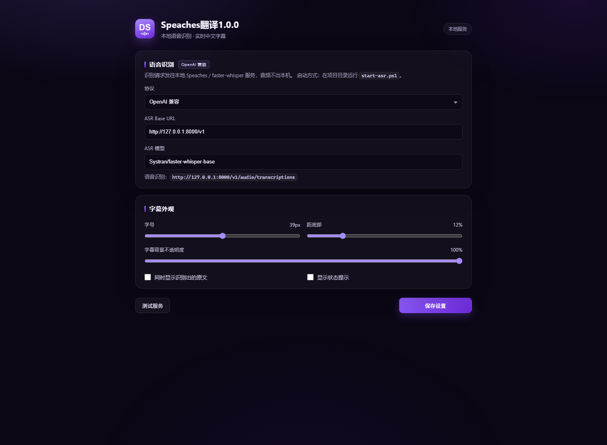

# YT音轨翻译

**直接监听 YouTube 标签页音轨，实时生成简体中文字幕的 Chrome 扩展（Manifest V3）。**

不读取、不依赖 YouTube 的 CC 字幕 —— 它捕获音频，交给本地语音识别，再用本地大模型翻译，字幕叠加在播放器内部（全屏可用）。

> ⚠️ **这不是一个装完即用的云端插件。** 语音识别和翻译都跑在**你自己的电脑**上，需要先启动两个本地服务（见下方「一键安装」）。好处是：不需要任何 API Key，音频和文字都不出本机，长期使用 0 成本。



## 功能

- **以音轨为准**：捕获标签页音频做识别，有没有 CC 字幕都能用
- **全本地**：语音识别用 faster-whisper，翻译用 Ollama 上的 `qwen2.5:3b`，不联网、无 Key
- **实时字幕悬浮层**：译文叠加在播放器内，支持全屏；可开关是否同时显示原文
- **字幕外观可调**：字号、距底部距离、背景不透明度
- **划词翻译**：任意网页选中文字，右键即可翻译
- **快捷键**：`Alt + Shift + A` 开始 / 停止

## 工作原理

```
YouTube 标签页音轨
   │ chrome.tabCapture
   ▼
Offscreen 文档：AudioContext + 能量 VAD
   │ 0.6–1.6 秒 WAV 分片（检测到静音提前切分）
   ▼
Service Worker ──► 本地 ASR  POST /v1/audio/transcriptions   (faster-whisper)
   │ 识别文本，跨分片去重
   ▼
Service Worker ──► 本地 LLM  POST /v1/chat/completions       (Ollama qwen2.5:3b)
   │ 流式返回简体中文
   ▼
Content Script ──► 播放器内 Shadow DOM 悬浮层
```

## 实测延迟

在 i5-14600KF + RTX 5060 上（7.67 秒音频）：

| 环节 | 耗时 |
| --- | --- |
| 语音识别 | 0.7–1.0 秒 / 1.5 秒分片 |
| 翻译 | 首字 0.03 秒，整句 0.09–0.15 秒 |
| **端到端** | **约 1.0–1.5 秒** |

## 一键安装（推荐）

先拿到仓库（含安装脚本）：

```powershell
git clone https://github.com/LeoHwang74/yt-audio-translator.git
cd yt-audio-translator
```

然后运行：

```powershell
powershell -ExecutionPolicy Bypass -File .\install.ps1
```

脚本会自动完成这些事：

| 步骤 | 内容 |
| --- | --- |
| 1 | 检测 Python 3.9+（没有会提示去装并退出） |
| 2 | 在 `%LOCALAPPDATA%\yt-audio-translator` 建独立 venv |
| 3 | 安装 `faster-whisper` / `fastapi` / `uvicorn` |
| 4 | 下载 `base` 语音模型（约 150 MB，只下一次） |
| 5 | 生成 `start-asr.ps1` 和 `start-all.ps1` |
| 6 | 设置 `OLLAMA_ORIGINS=*`（扩展能访问 Ollama 的关键） |
| 7 | `ollama pull qwen2.5:3b` |
| 8 | 启动识别服务并验证 `/health` |

常用参数：

```powershell
# 更准的模型 + 更多线程
.\install.ps1 -AsrModel small -Threads 20

# 换 Ollama 模型
.\install.ps1 -OllamaModel qwen2.5:7b

# 只装语音识别，跳过 Ollama
.\install.ps1 -SkipOllama

# 装完不自动启动
.\install.ps1 -NoStart

# 换安装位置
.\install.ps1 -InstallDir D:\tools\yt-translator
```

装完之后，日常只需一条命令启动全部服务：

```powershell
& "$env:LOCALAPPDATA\yt-audio-translator\start-all.ps1"
```

> 脚本是全英文输出（Windows PowerShell 读取无 BOM 的中文 `.ps1` 会乱码）。
> 它只写 `-InstallDir` 目录和你用户级的 `OLLAMA_ORIGINS` 变量，不动别的东西。

### 可选：让识别服务开机自启

Ollama 装完会自己随系统启动，识别服务不会。不想每次手动开的话，往启动文件夹放一个快捷方式：

```powershell
$startup = [Environment]::GetFolderPath('Startup')
$asr = Join-Path $env:LOCALAPPDATA 'yt-audio-translator'
$ws = New-Object -ComObject WScript.Shell
$sc = $ws.CreateShortcut((Join-Path $startup 'YT音轨翻译-识别服务.lnk'))
$sc.TargetPath = 'powershell.exe'
$sc.Arguments = '-NoProfile -WindowStyle Hidden -ExecutionPolicy Bypass -File "' + (Join-Path $asr 'start-asr.ps1') + '"'
$sc.WorkingDirectory = $asr
$sc.Save()
```

> 用 `.lnk` 而不是 `.vbs`：路径里有中文时，`.vbs` 若按 ASCII 保存会把中文写成 `?`，开机静默失败；`.lnk` 内部是 Unicode，不受影响。

## 手动配置（可选）

不想用脚本、想自己控制每一步的话，按下面来。

### ① 语音识别：faster-whisper（端口 8000）

需要一个暴露 `/v1/audio/transcriptions` 的 OpenAI 兼容接口。**这个实现已经包含在本仓库里**：`tools/asr_server.py`（约 150 行，FastAPI + faster-whisper）。`install.ps1` 会把它复制到安装目录并建好 venv。

手动跑也很简单：

```bash
pip install faster-whisper fastapi uvicorn python-multipart
python tools/asr_server.py          # 监听 127.0.0.1:8000
```

可用环境变量：`WHISPER_MODEL`（默认 `base`）、`WHISPER_THREADS`（默认 12）、`WHISPER_PORT`（默认 8000）。

也可以换成别的实现，例如 [Speaches](https://github.com/speaches-ai/speaches)（Docker）：
```bash
docker run -d --name speaches -p 8000:8000 \
  -v speaches-models:/home/ubuntu/.cache/huggingface/hub \
  ghcr.io/speaches-ai/speaches:latest-cpu
```

### ② 翻译：Ollama（端口 11434）

```bash
ollama pull qwen2.5:3b
```

**必须允许扩展来源**，否则 Ollama 会以 403 拒绝请求：

```bash
# Windows（用户环境变量，设完重启 Ollama）
setx OLLAMA_ORIGINS "*"

# macOS / Linux
export OLLAMA_ORIGINS="*"
```

## 安装

1. 下载 [Releases](../../releases/latest) 里的最新 zip 并解压，或直接克隆本仓库
2. 打开 `chrome://extensions`，右上角开启**开发者模式**
3. 点「加载已解压的扩展程序」，选择本仓库根目录（里面应直接有 `manifest.json`）
4. 刷新 YouTube 页面

需要 **Chrome 116+**（`offscreen` / `tabCapture`）。

## 设置

| 项 | 默认值 | 是否可改 |
| --- | --- | --- |
| 协议 | OpenAI 兼容 | 否（固定） |
| ASR Base URL | `http://127.0.0.1:8000/v1` | 是 |
| ASR 模型 | `Systran/faster-whisper-base` | 是 |
| 翻译 Base URL | `http://127.0.0.1:11434/v1` | 否（内置） |
| 翻译模型 | `qwen2.5:3b` | 否（内置） |
| Temperature | 0.3 | 否（内置） |

## 使用

1. 打开 YouTube 视频或直播
2. 点击工具栏里的 **YT音轨翻译** 图标
3. 点「开始音频翻译」，浏览器会要求授权捕获当前标签页音轨（Chrome 的安全限制，必须用户点击）
4. 播放器底部出现中文字幕；`Alt + Shift + A` 可开始 / 停止

## 排错

| 现象 | 原因 | 处理 |
| --- | --- | --- |
| 设置页点测试报 `Failed to fetch` | 识别服务没启动 | `curl http://127.0.0.1:8000/health`，没响应就跑 `start-asr.ps1` |
| 完全没字幕 | 同上，或页面未刷新 | 起服务后刷新 YouTube 页面再点开始 |
| 只有英文没有中文 | Ollama 没跑或模型没拉 | `ollama list` 确认有 `qwen2.5:3b` |
| 翻译请求 403 | Ollama 拒绝了扩展来源 | 设 `OLLAMA_ORIGINS=*` 后重启 Ollama |
| 翻译请求 404 `model not found` | 模型名不对 | `ollama pull qwen2.5:3b` |
| 识别很慢（3 秒以上） | 线程数太少 | `WHISPER_THREADS=12` 再启动；Whisper 延迟与音频长度无关，主要看线程 |

## 权限说明

| 权限 | 用途 |
| --- | --- |
| `tabCapture` | 捕获当前标签页音轨 |
| `offscreen` | 在隐藏文档中运行 AudioContext |
| `storage` | 保存设置 |
| `activeTab` / `scripting` | 在 YouTube 页面注入悬浮层 |
| `contextMenus` | 划词翻译、开始/停止 |
| `clipboardWrite` | 复制译文 |

`host_permissions` 只包含 `api.deepseek.com`、`127.0.0.1:8000`、`127.0.0.1:11434`。不申请麦克风、摄像头、历史记录。

## 目录

```
manifest.json
icons/                 紫色 YT 图标
install.ps1            一键安装本地服务（Python venv + 模型 + Ollama）
tools/
  asr_server.py        OpenAI 兼容的 faster-whisper 服务
src/
  background/          音轨会话、ASR 队列、翻译流
  content/             播放器悬浮层 / 划词气泡
  offscreen/           tabCapture + VAD + WAV 分片
  options/             设置页
  popup/               开始/停止
  shared/              设置、ASR 客户端、提示词、音频编码
```

## 免责声明

本项目与 Google、YouTube、DeepSeek、Ollama 官方无关联。仅用于个人学习与研究，请遵守目标网站的服务条款与所在地法律。

## License

[MIT](LICENSE)
